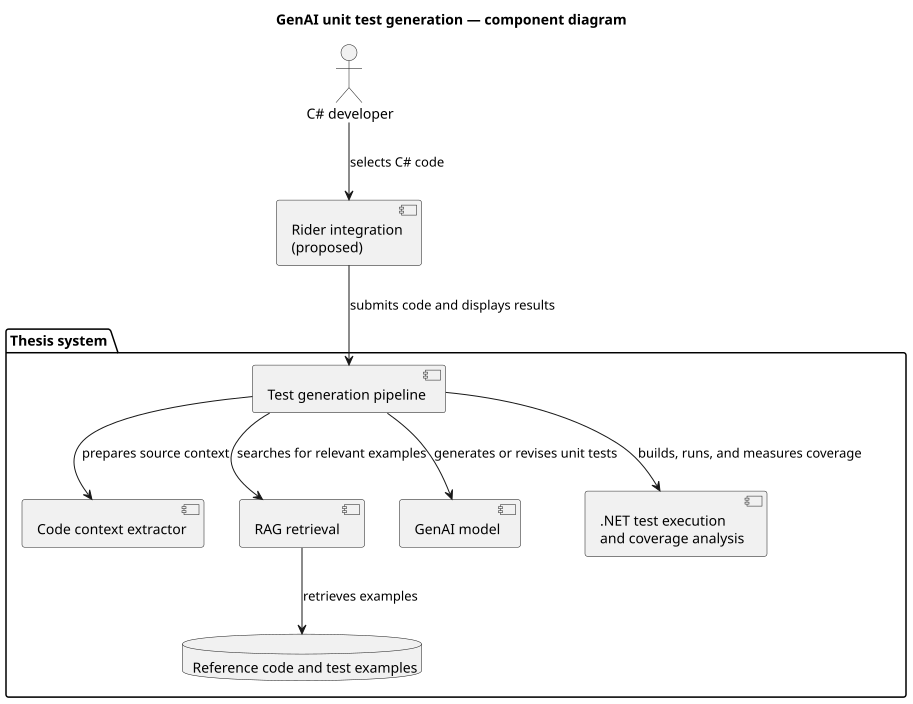
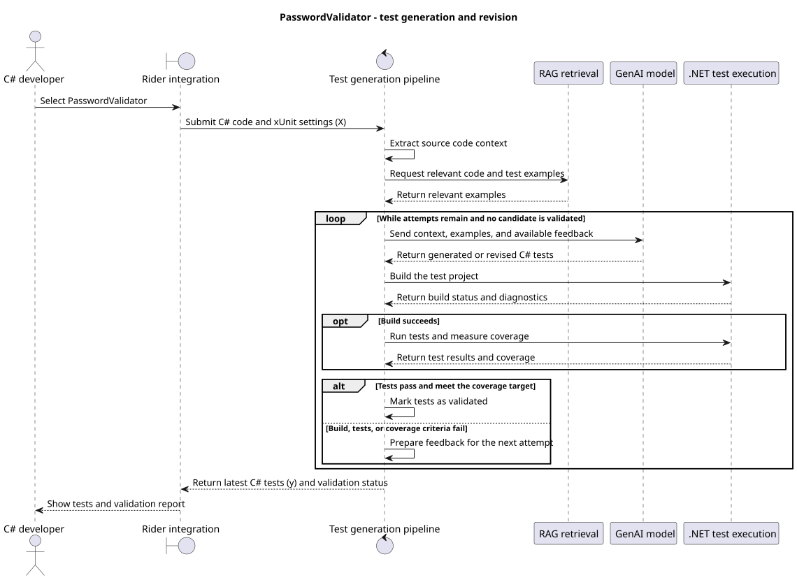

# Lab 1.3 — GenAI unit test generation in JetBrains Rider

## Selected company

I selected **JetBrains** as a candidate for the proposed integration. Rider supports C#/.NET development, runs xUnit tests, and provides code coverage analysis. JetBrains also documents the use of AI Assistant to generate unit tests in Rider. These capabilities make Rider a suitable environment for integrating the generation and validation stages of my thesis method.

[JetBrains Rider unit testing](https://www.jetbrains.com/help/rider/Unit_Testing__Index.html) · [Creating unit tests in Rider](https://www.jetbrains.com/help/rider/Create_Unit_Tests.html)

## Proposed integration

A developer selects a C# class or method in Rider. The input **X** includes the selected code and test settings, such as the use of xUnit. The pipeline extracts relevant source context, retrieves reference code and test examples using RAG, and passes both to a generative AI model. The model produces a candidate C# unit test suite. A .NET runner builds and runs the suite and measures code coverage when execution is possible.

If a build fails, a test fails, or coverage falls below the configured target, the pipeline uses the available diagnostics to request a revision. The process stops when the criteria are met or the attempt limit is reached. The output **y** is the generated C# test suite. The validation report indicates whether the suite met the criteria and records the available build, test, and coverage results.

## UML component diagram

The component diagram shows where the proposed Rider integration calls the thesis system and how the pipeline coordinates context extraction, RAG, GenAI, and .NET test execution.

[PlantUML source](../diagrams/components.puml)

## UML sequence diagram

The sequence diagram uses `PasswordValidator` from [Lab 1.2](examples.csv). It follows a single generation request from the selected C# class through xUnit test generation and validation, including the feedback used in the next attempt.

[PlantUML source](../diagrams/sequence.puml)

The diagrams were drafted with ChatGPT and rendered locally with PlantUML.
